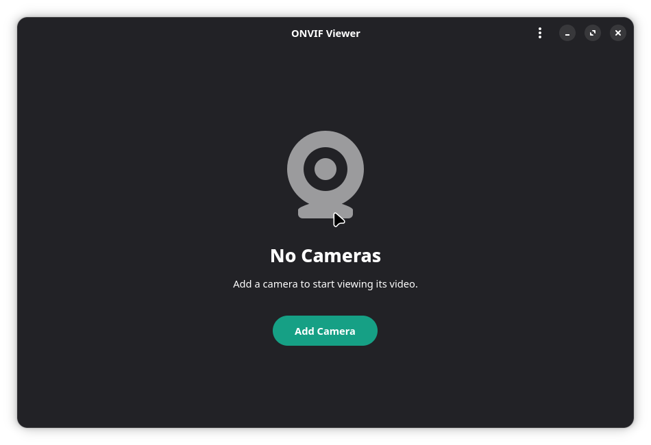
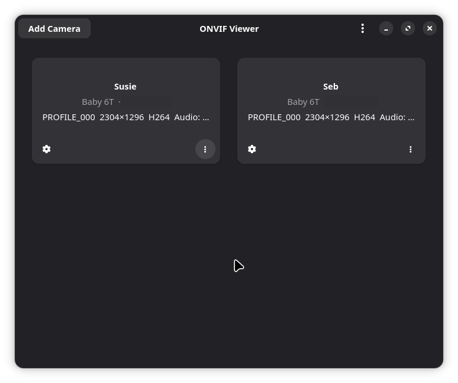
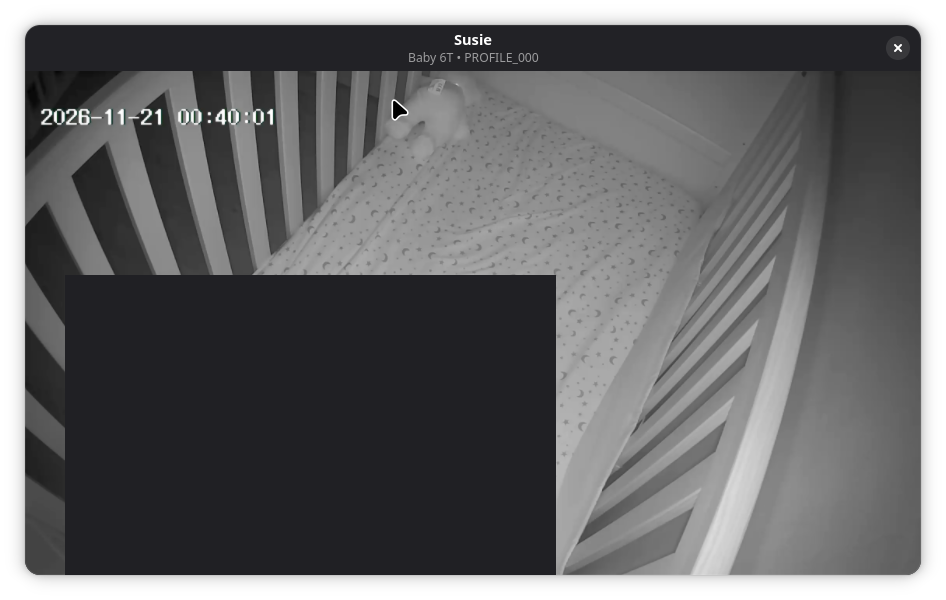

# ONVIF Viewer

A native Linux desktop application for viewing ONVIF cameras with GTK4, libadwaita, and GStreamer.

## Screenshots







## Requirements

Rust stable, Cargo, `pkg-config`, GTK4, libadwaita 1.4 or later, and GStreamer development libraries are required to build. Playback also requires the GStreamer GTK4 paintable sink, RTSP, audio output and appropriate depayloader and decoder plugins for the camera's streams (for example H.264 and G.711 plugins).

## Continuous integration

Pull requests run independent checks for formatting, Clippy, workspace tests, and a Conventional Commit title (for example, `fix: handle stream disconnects`). Editing a pull request reruns only the title check; new commits run all checks. Pushes to `main` run the Rust checks. Clippy and tests install the native development libraries on Ubuntu and cache Rust dependencies and build artifacts.

To run the Rust checks locally:

```sh
cargo fmt --all -- --check
cargo clippy --workspace --all-targets --locked -- -D warnings
cargo test --workspace --locked
```

## Run

```sh
cargo run
```

Select **Add Camera**, then enter its ONVIF device service URL including its port, username, and password. Select a camera tile to open its feed. Use the tile's settings button to edit or remove the camera, and its profile menu to choose a stream; changing the profile also switches any open feeds.

In a feed window, use **Take Snapshot** in the bottom toolbar to request a still image from the camera and choose where to save it. The snapshot uses the selected ONVIF media profile and may differ from the live video in resolution or timing. Capture and file errors are shown in the window.

Camera tiles and newly opened feed windows use the selected profile's aspect ratio when its dimensions are known. On Wayland, the compositor controls interactive window resizing, so the window itself cannot be locked to that ratio; the video remains undistorted and is letterboxed when necessary.

RTSP playback uses a 500 ms jitter buffer and drops packets when that buffer fills, rather than letting it grow without limit. This favors staying near live over uninterrupted playback: unstable networks can cause stutter, missing audio, or video artifacts until the next keyframe. GStreamer continues to synchronize audio and video. This bounds the RTSP jitter buffer, not total end-to-end delay; camera-side buffering, transport delays, decoding, and clock drift can still affect playback.

The feed window shows a packet-drop count while the jitter buffer reports late or latency-limit drops, and hides it five seconds after the last report. GStreamer rate-limits these reports, so the count may omit drops; it is not a measurement of camera delay or proof that drift was corrected.

The camera library and selected profiles are stored in `${XDG_DATA_HOME:-~/.local/share}/onvif-viewer/library.sqlite3`. Camera passwords are stored separately in the desktop keyring through Secret Service, not in the database. A running, unlocked Secret Service keyring is required to load and change the library; unlock the keyring or start the desktop keyring service if the application reports a storage error. Removing a camera also removes its stored password. Closing a feed stops playback, and removing a camera closes its feed windows.

Camera credentials are used for ONVIF authentication and RTSP playback. Use HTTPS for the ONVIF service when available; ONVIF password digests do not encrypt camera traffic. Device service addresses must not contain credentials, query parameters, or fragments.
