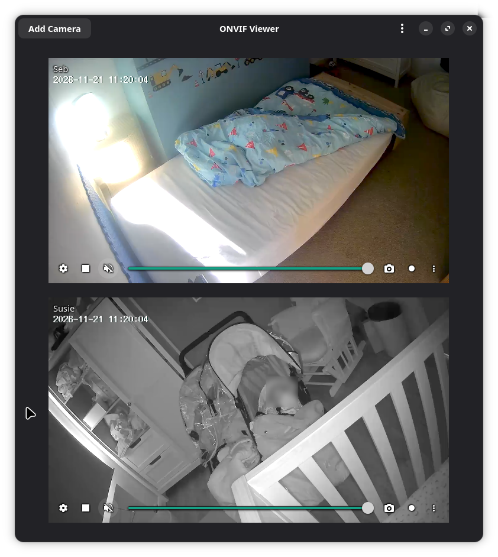

# ONVIF Viewer

A native Linux desktop application for viewing ONVIF cameras with GTK4, libadwaita, and GStreamer.

## Screenshots



## Requirements

Rust stable, Cargo, `pkg-config`, GTK4, libadwaita 1.4 or later, and GStreamer development libraries are required to build. Playback also requires the GStreamer GTK4 paintable sink, RTSP, audio output and appropriate depayloader and decoder plugins for the camera's streams (for example H.264 and G.711 plugins). Snapshots require a GStreamer JPEG encoder. Recording additionally requires the Matroska muxer and appropriate RTP depayloaders/parsers.

## Continuous integration

Pull requests run independent checks for formatting, Clippy, workspace tests, and a Conventional Commit title (for example, `fix: handle stream disconnects`). Editing a pull request reruns only the title check; new commits run all checks. Pushes to `main` run the Rust checks. Clippy and tests install the native development libraries on Ubuntu and cache Rust dependencies and build artifacts.

To run the Rust checks locally:

```sh
cargo fmt --all -- --check
cargo clippy --workspace --all-targets --locked -- -D warnings
cargo test --workspace --locked
```

## Run

```sh
cargo run
```

Select **Add Camera**, then enter its ONVIF device service URL including its port, username, and password. Each camera appears in the main-window grid. Use its play button to start the lowest-resolution available profile; the button stops playback when selected again. Grid audio starts muted and can be adjusted with the tile's mute button and volume slider. Connection and playback errors appear on the affected tile.

Select the video area to open a separate feed window. The grid stream stops while feed windows for that camera are open and resumes when the last one closes if it was playing before. Use the tile's settings button to edit or remove the camera. The profile menu on either surface chooses the profile for feed windows; changing it also switches any open feeds. The feed window has its own mute and volume controls.

Camera Settings also retrieves device information from the saved ONVIF address and credentials. Manufacturer, model, firmware version, and serial number are shown when the device supplies them; missing values are unavailable. A connection failure can be retried without changing the saved settings. Information describes the saved connection, not unsaved edits.

When a camera profile supports continuous pan and tilt, its grid tile and feed toolbar offer a directional control toggle. Turn it on to capture arrow keys: hold a key to move the camera and release it to stop. Only one grid tile captures keys at a time. Capture turns off and movement stops when the window loses focus, the camera is removed or updated, or its feed opens or changes profile. Grid controls use the grid stream's lowest-resolution profile; feed controls use the selected feed profile. Camera-side movement timeouts limit motion if the connection fails; cameras must honor those timeouts.

Use the camera icon on a playing tile or feed window to save the current decoded video frame as a JPEG. Snapshots use the live stream's resolution and may reflect its buffering delay. The suggested filename includes the local date and time. Capture and file errors are shown separately.

Use the record icon to choose a local `.mkv` destination and record that surface's stream profile: the lowest-resolution profile for a grid tile, or the selected profile for a feed window. The icon changes to a stop button while recording; its tooltip reports when recording starts or the file is being saved. A grid recording continues when its preview is stopped or opened in a feed window. The save location is chosen for each clip and is never stored with the camera configuration.

Recordings are remuxed rather than decoded and re-encoded, preserving compressed H.264/H.265 video and AAC, Opus, PCMA, or PCMU audio when the camera provides them. Other codecs are not currently recorded. Clips begin at the next usable stream data/keyframe and have no pre-event buffer; recording camera-side events and background/pre-event capture are intentionally outside this feature. Closing a feed requests a clean stop and lets the independent recorder finalize its file; do not force-quit the application while **Saving recording…** is displayed.

The main-window grid chooses its columns using both available width and height to make camera tiles as large as practical; it scrolls when the cameras cannot all fit at a usable size. Tiles use the lowest-resolution profile's aspect ratio when its dimensions are known, and video remains undistorted. Newly opened feed windows use the selected profile's aspect ratio when its dimensions are known. On Wayland, the compositor controls interactive window resizing, so the window itself cannot be locked to a ratio; video is letterboxed when necessary.

RTSP playback uses a 500 ms jitter buffer and drops packets when that buffer fills, rather than letting it grow without limit. This favors staying near live over uninterrupted playback: unstable networks can cause stutter, missing audio, or video artifacts until the next keyframe. GStreamer continues to synchronize audio and video. This bounds the RTSP jitter buffer, not total end-to-end delay; camera-side buffering, transport delays, decoding, and clock drift can still affect playback.

The feed window shows a packet-drop count while the jitter buffer reports late or latency-limit drops, and hides it five seconds after the last report. GStreamer rate-limits these reports, so the count may omit drops; it is not a measurement of camera delay or proof that drift was corrected.

The camera library and selected profiles are stored in `${XDG_DATA_HOME:-~/.local/share}/onvif-viewer/library.sqlite3`. Camera passwords are stored separately in the desktop keyring through Secret Service, not in the database. A running, unlocked Secret Service keyring is required to load and change the library; unlock the keyring or start the desktop keyring service if the application reports a storage error. Removing a camera also removes its stored password. Closing a feed stops playback, and removing a camera closes its feed windows.

Camera credentials are used for ONVIF authentication and RTSP playback. Use HTTPS for the ONVIF service when available; ONVIF password digests do not encrypt camera traffic. Device service addresses must not contain credentials, query parameters, or fragments.
